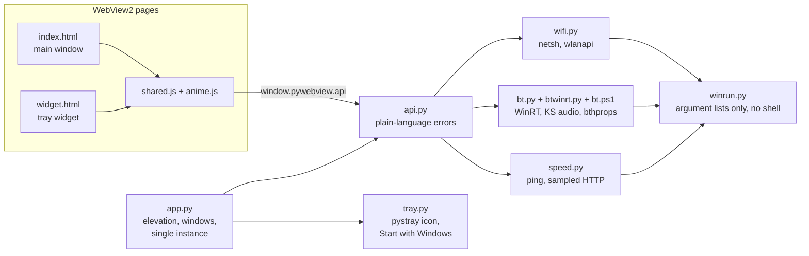

<div align="center">


# Unigen Manager

**Manage the Unigen USB Wi-Fi 6 + Bluetooth dongle and a laptop's built-in Wi-Fi card side by side, from one dark-mode window and an always-on tray widget.**


<a href="https://github.com/ApurvDas/unigen-manager/releases/latest/download/UnigenManager.exe"></a>

**Plug and play:** download, double-click, done. No installer, no Python.

[Quick start](#quick-start) · [Features](#features) · [Usage](#usage) · [Run from source](#run-from-source) · [Development](#development) · [Security](#security)


</div>

## Quick start

| Step | What to do |
|:---:|---|
| **1** | Plug in the Unigen dongle. Its driver must be installed, so the dongle shows up in Windows' Wi-Fi list. |
| **2** | **[Download UnigenManager.exe](https://github.com/ApurvDas/unigen-manager/releases/latest/download/UnigenManager.exe)**: one file of about 33 MB. |
| **3** | Double-click it and choose **Yes** at the Windows prompt. |

That's it. The window opens, and a cyan icon appears in the taskbar's **^** flyout. Nothing is installed: the app runs from the `.exe` wherever you keep it, for example `C:\Apps\Unigen Manager\`.

> **"Windows protected your PC"?** The `.exe` isn't code-signed, so SmartScreen warns about it the first time. Click **More info ▸ Run anyway**.

**To remove it:** untick **Start with Windows** in the tray menu if you turned it on, quit from the tray, then delete the `.exe` and `%LOCALAPPDATA%\UnigenManager\`.

Older versions and checksums are on the [releases page](https://github.com/ApurvDas/unigen-manager/releases). Developers can [run from source](#run-from-source).

## Features

<table>
<tr>
<td width="50%" valign="top">

### 📶 Wi-Fi
- See nearby networks with signal, band and channel.
- A channel map for 2.4 and 5 GHz shows which channels are crowded.
- Connect, disconnect, or add a new WPA2 or open network with its password.
- **Saved networks:** show a password, copy a network to the other adapter, or hold to delete.

</td>
<td width="50%" valign="top">

### 🎧 Bluetooth
- **Live search:** nearby devices appear as Windows finds them, and the search stops when you leave the page.
- **Pairing with PIN prompts:** confirm a code, type the code the device shows, or enter the device's PIN, right in the app.
- Bluetooth **on/off switch**, here and in the tray widget.
- Remove devices, and connect or disconnect audio devices.
- Switch between the dongle's radio (Bluetooth 5.4) and the built-in one (5.2).
- If the new radio doesn't start within 10 seconds, the app switches back on its own.

</td>
</tr>
<tr>
<td valign="top">

### ⚡ Speed
- A live throughput curve for each adapter, with download and upload shown separately.
- Both adapters compared side by side: download, upload, link rate and ping.
- Signal strength of each adapter over the last 2 minutes.

</td>
<td valign="top">

### 🧭 Always-on tray widget
- Live status of both adapters, and a **Wi-Fi uses** switch that moves the connection to one adapter.
- Quick connect to saved networks, the Bluetooth radio switch, and a mini speed test.
- Optional **Start with Windows**.

</td>
</tr>
</table>

Each adapter shows its own standards, read from the hardware: **Wi-Fi 6**, **Bluetooth 5.4** for the Unigen dongle and **5.2** for the MediaTek card. The motion is built with anime.js and turns into simple fades when Windows' **Show animations** setting is off.

<div align="center">

| Bluetooth | Speed | Tray widget |
|:---:|:---:|:---:|
|  |  |  |

</div>

## Requirements

| | |
|---|---|
| **Windows** | 10 or 11, **set to English** (the app reads `netsh` output) |
| **Python** | Not needed for `UnigenManager.exe`. To run from source: [3.10](https://www.python.org/downloads/release/python-31011/), with the `py` launcher (installed by default) |
| **WebView2** | Microsoft Edge WebView2 Runtime, already present on up-to-date Windows |
| **Rights** | Administrator, for Bluetooth radio switching and Start with Windows (the app asks when it starts) |
| **Hardware** | Built for the Unigen AIC8800D80 dongle and MediaTek MT7921 card. Other Wi-Fi adapters show up under their Windows names |

## Run from source

Only needed for development. Everyone else can use [the `.exe`](#quick-start).

<details>
<summary><b>1. Download</b></summary>

- **Git:** `git clone https://github.com/ApurvDas/unigen-manager.git`
- **ZIP:** **Code ▸ Download ZIP** on this page, then extract it, for example to `C:\Users\<you>\UnigenManager`.

</details>

<details>
<summary><b>2. Install</b></summary>

Open a terminal in the project folder:

```powershell
py -3.10 -m pip install -r requirements.txt
```

That installs pywebview, pystray, Pillow and the WinRT packages used for Bluetooth. anime.js already ships in `ui/vendor/`.

</details>

<details>
<summary><b>3. Run</b></summary>

```powershell
py -3.10 UnigenManager.pyw
```

Choose **Yes** at the Windows prompt. If you choose **No**, the app still runs, but Bluetooth radio switching is turned off.

Create a desktop shortcut (optional):

```powershell
py -3.10 app.py --install-shortcut
```

</details>

## Usage

| Action | How |
|---|---|
| Switch screens | Side menu, or <kbd>Ctrl</kbd>+<kbd>1</kbd> Wi-Fi · <kbd>Ctrl</kbd>+<kbd>2</kbd> Bluetooth · <kbd>Ctrl</kbd>+<kbd>3</kbd> Speed |
| Connect | Double-click a network, or select it and press <kbd>Enter</kbd> |
| Delete a saved network, or remove a device | Press and hold the button for 1.5 s; let go early to cancel |
| Open the widget | Click **^** on the taskbar, then the cyan icon. Click anywhere else or press <kbd>Esc</kbd> to close |
| Start with Windows | Right-click the tray icon and tick **Start with Windows** (a scheduled task; keeps running on battery) |
| Quit | Right-click the tray icon and choose **Quit**. Closing the main window only hides it |

Opening the app again while it's running brings the existing window forward, so only one copy runs at a time.

**Command-line options**

| Flag | Effect |
|---|---|
| `--tray` | Start with only the tray icon (the main window stays hidden) |
| `--no-elevate` | Don't ask for administrator rights |
| `--debug` | Open WebView developer tools |
| `--install-shortcut` | Create the desktop shortcut and exit |

The options work the same way on the `.exe`, for example `UnigenManager.exe --tray`.

App data such as the last speed results and `app.log` lives in `%LOCALAPPDATA%\UnigenManager\`.

## Development

**Preview the UI in a browser.** Both pages include a mock API with sample data:

```powershell
py -3.10 -m http.server 8765 --directory ui
```

Then open:
- `http://127.0.0.1:8765/index.html?mock` for the main window
- `http://127.0.0.1:8765/widget.html?mock` for the widget, above a fake taskbar

**Run the tests**

```powershell
py -3.10 -m pip install -r requirements-dev.txt
py -3.10 -m pytest                 # 176 unit, contract and UI tests (UI tests drive the installed Microsoft Edge)
py -3.10 -m pytest -m hardware     # read-only checks against the real adapters (changes nothing)
```

Checks that change system state (connecting, pairing, radio switching, unplugging the dongle) are in the [manual checklist](docs/superpowers/test-reports/manual-checklist.md).

### Build the .exe

```powershell
py -3.10 -m pip install -r requirements-dev.txt
py -3.10 build_exe.py
```

This writes `dist\UnigenManager.exe`: one file of about 33 MB, with no console window, that runs without Python. PyInstaller bundles the Python runtime, the `ui/` folder and `bt.ps1`, and `build_exe.py` draws the app icon from the tray logo. When the app runs as the `.exe`, the admin prompt, the desktop shortcut and Start with Windows all point at the `.exe` itself.

**Version numbers:** releases go 1.0.0, 1.0.1, … 1.0.9, then 1.1.0. Each part counts 0 to 9 and then rolls into the next one up (1.9.9 becomes 2.0.0). `version.py` holds the number of the next release, and `version.bump()` works out the one after it.

### How it fits together



| Path | What it does |
|---|---|
| `UnigenManager.pyw` | Double-click launcher |
| `app.py` | Administrator prompt, single instance, main and widget windows, tray |
| `api.py` | Everything the pages call, with plain-language errors |
| `wifi.py` | `netsh` parsing, connect and disconnect, saved profiles, Windows scan request |
| `bt.py`, `bt.ps1` | Bluetooth radio switching and audio connect |
| `btwinrt.py` | Bluetooth through Windows' WinRT device APIs: paired list, live search, pairing with PIN prompts, unpair, radio power |
| `speed.py` | Ping and per-adapter sampled download and upload |
| `tray.py` | Tray icon, widget placement, Start with Windows, single instance |
| `winrun.py` | The only place that starts processes |
| `ui/` | `index.html`, `widget.html`, `shared.css`, `shared.js`, `mock-api.js`, vendored anime.js |
| `tests/` | pytest suites, Playwright UI tests, read-only hardware tests, captured `netsh` fixtures |
| `docs/superpowers/` | Design spec, implementation plan and the manual checklist |

## Security

- **Untrusted names:** anyone nearby can name a network or device, so names are always shown as text and handed to Windows tools as separate arguments, never as command text.
- **Passwords** are never logged. They only touch the disk inside temporary folders that are deleted straight away.
- **Start with Windows** runs the app with administrator rights at sign-in, without a prompt. The app's files live in your user folder, so anything that can change those files could gain administrator rights at your next sign-in. Leave the option off if that trade-off isn't right for you.

## Known limitations

- Windows must be in English. On other languages, the app shows *"Is Windows set to English?"* instead of wrong data.
- Network names with non-English characters may display incorrectly, and you can't connect to them from the app.
- New WPA3 and Enterprise networks must be added in Windows settings. Once saved, they connect normally.
- **Bluetooth audio Connect and Disconnect:**
  - The app first asks the device's audio driver to reconnect, the same way Windows Settings does.
  - If that fails it toggles the device's audio services, and if Windows still refuses, it opens Windows Bluetooth settings instead.
  - Which of the three works is still to be confirmed on real hardware (checklist row 24).
- Pairing a device that isn't in pairing mode times out after about a minute.
- An adapter plugged in after the app starts appears after the app restarts.

## Built with

[pywebview](https://pywebview.flowrl.com/) · [pystray](https://github.com/moses-palmer/pystray) · [Pillow](https://python-pillow.org/) · [anime.js](https://animejs.com/) (MIT) · [Playwright](https://playwright.dev/python/) and [pytest](https://pytest.org/) for tests

The network names, addresses and device names in the tests and screenshots are made up.
